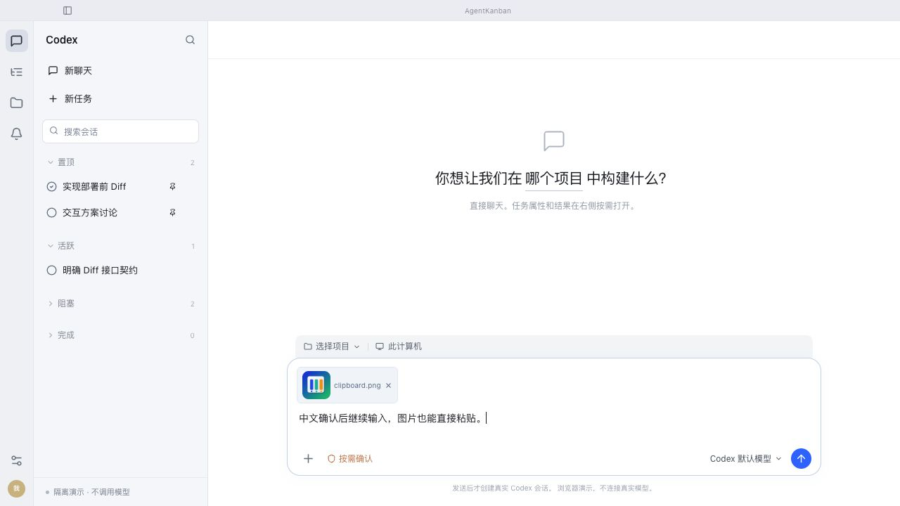

# 主会话输入法与图片粘贴验收

2026-10-28，本机正式 APP 已更新。仅本机安装，未提交、推送或对外发布。

## 问题与修复

输入法原来只检查 keydown.isComposing，遗漏组合生命周期及 WebKit compositionend 后的 229 确认键。现在同时检查三者，不加吞掉普通 Enter 的固定冷却时间。Enter 发送、Shift+Enter 换行保留。

剪贴板图片复用既有文件附件路径；items 与 files 只取一份，纯文字粘贴保持浏览器默认行为。图片可预览、移除、单独发送。保留 4 MB/文件、16 附件/消息的既有边界，读取前检查整批，单活跃读取；读取期间暂停发送但允许继续输入，完成后合并最新草稿。切换会话或卸载中止旧读取，迟到结果不得进入新旧会话。

## 可复核结果

| 场景 | 证据与结论 |
| --- | --- |
| 回归测试确实捕获旧问题 | 首次 5 用例中 4 失败、1 通过：两种误发送时序、缺图片粘贴与移除；见 red.log |
| 自动回归 | 11 条新增用例；完整前端 110/110 通过，见 tests.log |
| 构建与审查 | TypeScript/Vite 与 macOS app 构建通过；独立 reviewer 复跑 11/11、无阻塞；git diff --check 通过 |
| 浏览器真实剪贴板 | Clipboard PNG→Cmd+V→预览→移除→再次粘贴，草稿保留；见 paste-preview.png |
| macOS 系统图片剪贴板 | 独立 bundle/临时数据库：系统文件选择器载入 repo 图标，WKWebView 右键 Copy Image；移除旧附件，Cmd+V 后出现 image.png 新预览与可用发送按钮；见 native-paste-ax.txt |
| macOS 真实拼音 | 原生按键 n/i/Space 输入“你”；h/a/o/Enter 后保留“你hao”、未进入发送流程；继续 n/i/Space 得到“你hao你”；下一次普通 Enter 进入项目选择（此测试未选择项目，未启动模型）；见 native-ime-confirm-ax.txt、native-normal-enter-ax.txt |
| 既有附件和草稿迁移 | 既有 ChatApp 测试覆盖文本附件与任务草稿迁移；完整回归通过 |
| 本机安装 | 安装前无活动执行或待变更，当前任务树无编辑草稿；退出、备份安装、正常重启；签名通过，正式二进制与构建一致，隔离验收代码去签名后摘要相同 |
| 正式状态 | 320 条任务（319 可见）、会话/工作状态及权限摘要前后相同；见 install-checks.json |

本轮不改后端附件协议、模型连接或数据库；纯图片实际模型识别未消耗真实请求验证，发送 payload 由集成测试核对。真实输入法验证与图片系统剪贴板验证已在 macOS WKWebView 完成；未将 jsdom 事件伪装成此项原生验收。浏览器截图承担可见布局证据，原生使用实际操作及 AX 记录。

