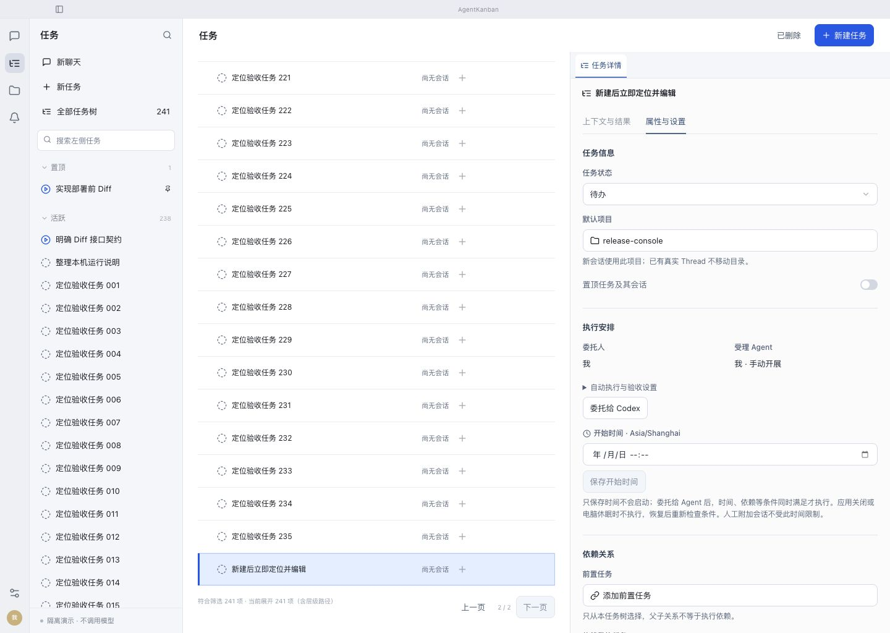

# 新建任务后保留任务树与定位

2026-10-28。已修复、回归并安装到正式 APP，未提交或推送。

## 行为和边界

- 任务入口新建根任务或添加子任务后，保留任务树，选中新任务、展开祖先、切换正确页码并滚动到新增行。行使用更清楚的蓝色背景与边线，右侧显示对应详情，保留用户原先的详情页签。
- 当前筛选可显示新任务时保持筛选；只有被筛选排除时切回全部任务，并提示调整原因。不会为了创建任务而启动会话或 Agent。
- 定位请求在 DOM 就绪后执行并消费；后台轮询不重复触发滚动或抢焦点。会话入口新建保留原来的导航方式。

## 根因和修正

1. 创建成功原先无条件调用 openTask，进入会话。任务入口改用树定位，选择与打开会话分开。
2. 原树定位没有处理折叠祖先、筛选和200行分页。现在按展开后的真实可见顺序计算页码，滚动后消费请求。
3. 独立审查发现时间筛选使用最多30秒前的树时钟，会把新任务当成未来数据排除。三档时间筛选用例均复现失败，改为每次数据/筛选重算使用当前时间；30秒 tick 继续处理自然过期。
4. 有效快照同步更新导航读取的 latest，创建后无需等待 React 提交。补充无会话任务下连续创建的回归。

## 验收

| 检查 | 结果与证据 |
| --- | --- |
| 自动回归 | 完整前端 **99/99** 通过，含本轮8项：普通新建、折叠子任务、筛选排除、跨200行分页、无会话下连续新建及day/week/month保留筛选。[日志](evidence/frontend.log) |
| 浏览器真实布局 | 隔离夹具240项任务，最近24小时筛选下创建第241项，直接切第二页；scrollTop=1539，新增行 top=895.19、bottom=948.19，位于任务区84–1024内；焦点在新增行，聊天区未显示。[实测](browser-metrics.json) |
| macOS WKWebView | 独立 bundle、独立数据库，创建 E2E 任务后任务树仍显示，焦点位于新行 container，右侧详情对应新任务。[AX记录](macos-create.txt) |
| 不隐式执行 | 隔离库中新任务的会话数和工作执行记录均为0。[数据库核对](native-checks.json) |
| 构建与审查 | TypeScript、Vite、Tauri打包与签名通过；独立增量审查无剩余阻塞，三档时间筛选及连续创建4项独立复跑通过；diff检查和OpenSpec严格验证通过。[构建](evidence/build.log) |
| 正式安装 | 安装前无自动或人工活动执行；320条任务、工作状态、全部会话权限与安装前一致。安装二进制与构建一致，隔离验收应用剥离签名后的代码与构建一致，三份签名验证通过。[核对](evidence/install-checks.json)、[安装日志](evidence/install.log) |

macOS截图接口此次返回白图，已弃用，未把它作为视觉证据；高亮和可视区以浏览器截图/布局读数验证，客户端以实际操作及AX焦点记录验证。浏览器的临时多任务夹具验证后已删除。没有在正式数据库创建验收任务。

## 回退

安装助手保留旧应用副本，具体位置见安装日志。本轮无存储迁移；如需回退，先检查活动执行，再退出并恢复旧包。回退界面不会撤销已发生的业务动作。
