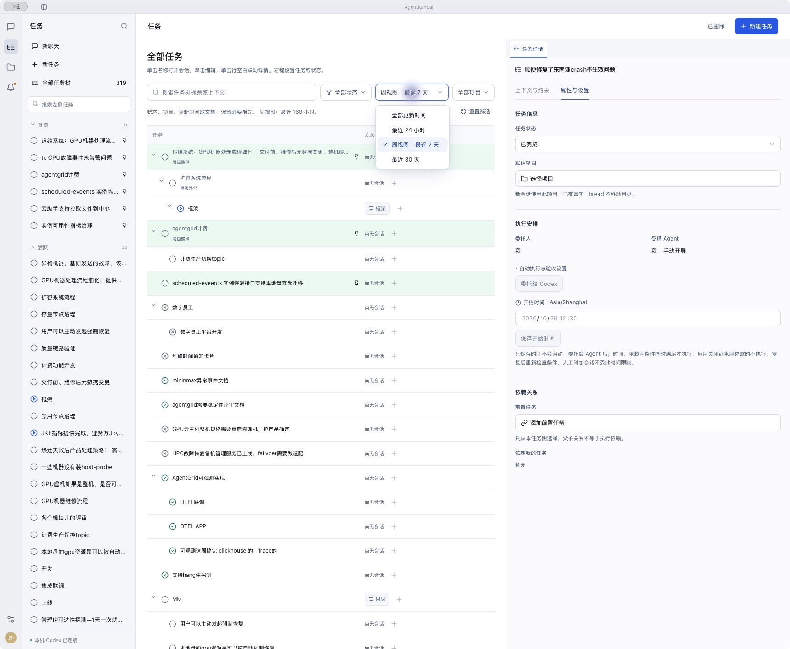

# 工作台 UI 一致性验收

2026-10-28。已实现、验证并安装到 `~/Applications/Codex Thread Kanban.app`，正式 APP 已重启。代码保留在 main，未提交或推送。

## 可直接复核的结果

- 普通搜索、筛选、状态、项目、日期输入统一 36px；紧凑操作 32px。控件 13px、辅助说明 12px，统一边框、圆角、禁用与焦点状态。
- 更新时间、任务状态、新建任务项目、模型、推理强度、权限及高级配置使用同一自定义选择组件，列表提供选中标记、悬停、滚动和边缘避让。studio 源码已无原生 select 标签；Radix 内部用于表单兼容的隐藏 select 不呈现原生菜单。
- 属性分为任务信息、执行安排、依赖关系、会话环境；原生 Thread 标识和目录按需展开。任务、会话、项目、设置、待办、弹窗统一文字和间距。
- 日期输入的高度和外观已统一，日历弹层继续使用 datetime-local 的系统日历；日期保存与本地时区语义不变。

## 验收清单及证据

| 场景 | 结果与证据 |
| --- | --- |
| 同排控件等高 | 1440×1024 实测搜索/状态筛选/更新时间/项目筛选及属性状态/项目/日期均 36px；见 [任务筛选](after/01-task-filter.png)、[属性菜单](after/02-task-properties.png) |
| 弹窗内菜单显示 | 实测菜单及 Radix wrapper 的 z-index=220，高于蒙层90；宽542px等于触发器542px；[模型弹窗](after/10-model-settings.png)、[真实 macOS 菜单](after/11-macos-model-list.png) |
| 空值、旧值及异步选项 | 空值与业务值 option:0 往返、旧模型值保留、动态标签更新、禁用不触发均通过组件测试 |
| 键盘交互 | 方向键跳过禁用项，Enter 选择并返回焦点；Escape 只关闭列表保留弹窗和值；Tab 移至下一表单操作；输入 h 跳至 high。macOS 实测 End/Enter/Escape/Tab，见 [焦点记录](macos-keyboard.txt) |
| 长列表及长文字 | 隔离浏览器夹具51项，高度320px、viewport318px、scrollHeight1662px、End 后 scrollTop1344px；第50项长文案换行，禁用第49项被方向键跳过；[窄屏长列表](after/12-long-list-narrow.png) |
| 窄窗口 | 1024×768 body宽1024px无横向溢出；搜索独占首行，三个筛选同在第二行且均36px；详情保持可读，[窄屏任务](after/04-task-narrow.png) |
| 其它入口 | [新建任务](after/03-create-task.png)、[设置](after/05-settings.png)、[项目](after/06-projects.png)、[待办空态](after/07-attention.png)、[会话](after/08-conversation.png)、[权限](after/09-permissions.png) |
| 业务回归 | 原有任务筛选及持久化、预约保存与时区、权限版本冲突、旧权限策略和预设切换测试通过。UI 本轮无后端及存储变更 |

长列表夹具只为验证组件布局和交互，不连接模型、账户或正式库，验证后已删除。待办截图为空态，不据此宣称全部业务审批卡片的视觉状态已穷尽。

## 自动检查与独立审查

- `make test` 通过：89项前端、136项 Rust 库、2项其它 Rust、18项 Python。随后补充旧值/异步和禁用测试，最终完整前端重跑 **91/91**；最终合计 **247项** 通过。[完整检查](evidence/make-test.log)、[最终前端](evidence/frontend-final.log)。
- `npm --prefix src-ui run build:app` 通过，包含 TypeScript 检查、Vite 构建、Tauri 打包及 ad-hoc 签名验证。[构建日志](evidence/app-build.log)。
- `git diff --check`、`openspec validate unify-workbench-controls --strict` 通过。
- 独立只读审查完成。初审后真实客户端发现 portal 被后加载 Tailwind z-50 覆盖，列表落在蒙层下且宽度偏窄；已提高组件作用域优先级，重新构建、macOS截图复验并增量审查，无剩余阻塞。

## 正式安装核对

安装前核对自动与人工会话均无活动执行，正式库备份保存在 `/tmp/agent-kanban-ui-20261028/formal-before-install.db`。安装助手保留旧应用：`~/Applications/Codex Thread Kanban.backup-da96a8c5b9cf4e84b7719cea41db145e.app`。

安装后核对：320条任务数量、工作执行状态、所有会话权限均与安装前一致；已安装二进制 SHA256 与构建一致；隔离验收应用剥离签名后的可执行代码与正式构建一致，三份应用的完整签名均验证成功。见 [安装核对](evidence/install.json)、[安装日志](evidence/install.log)。未发起正式任务执行或修改其权限。

保留 [整改前审计与截图](audit.md) 供对照。此次结论限定为本机工作台 UI；不替代先前单独约定的业务流程验证。

## 同日修订：项目列表仅显示名称

按用户补充要求，任务默认项目和会话项目选择器移除路径行及路径悬停提示；任务项目筛选同步移除路径提示。项目管理页的实际路径保留，按目录检索、项目 ID 绑定和会话固定目录不变。

35项项目选择及工作台回归通过，重新构建、签名验证、安装并重启正式 APP。浏览器与正式客户端均核对名称显示；管理页仍有路径。见 [界面截图](after/14-project-names.png)、[macOS记录](evidence/project-name-macos.txt)、[回归](evidence/project-name-test.log)、[构建](evidence/project-name-build.log)、[安装核对](evidence/project-name-install.json)。此次安装前无活动执行，320条任务、执行状态与权限均保持一致。
