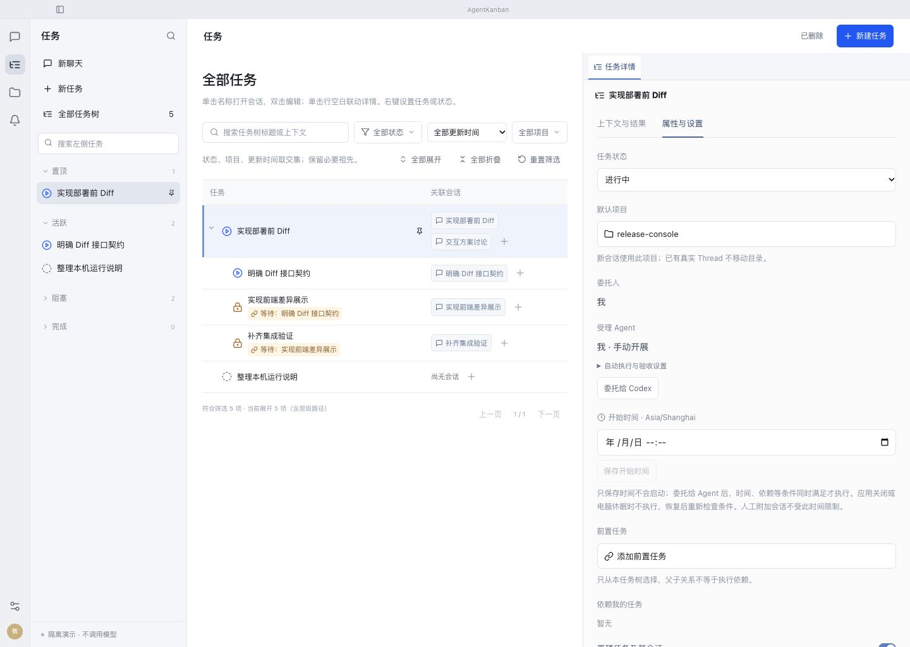
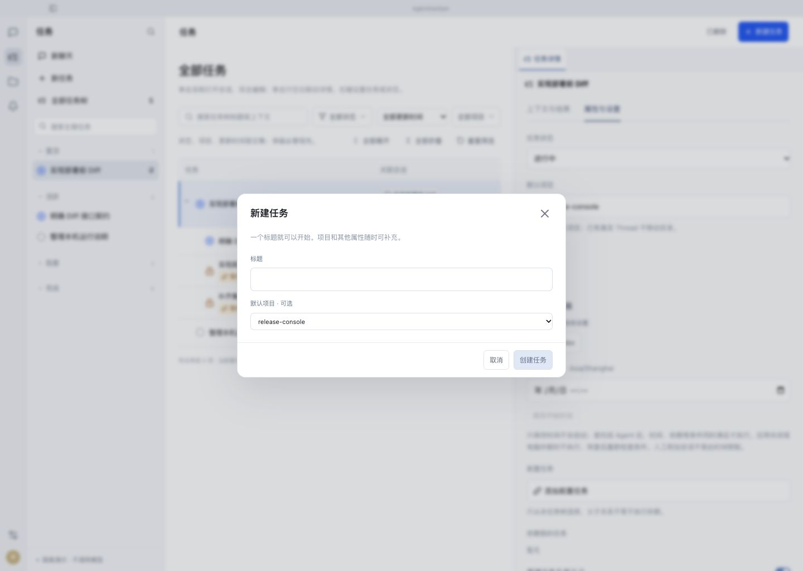
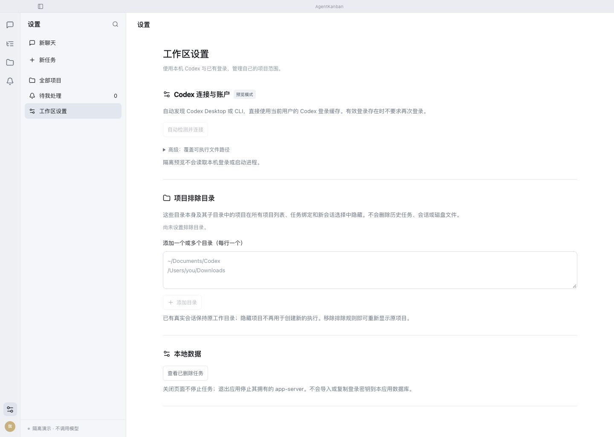
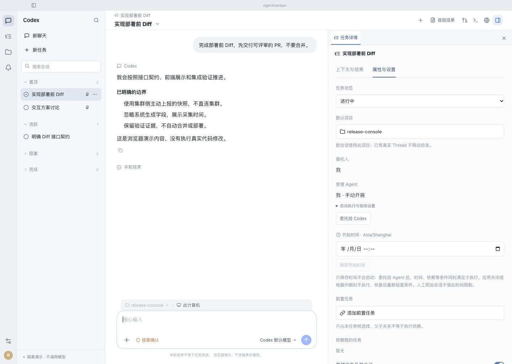
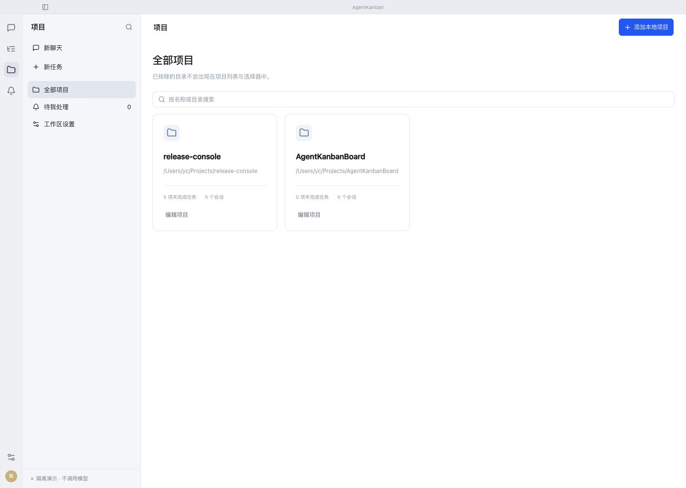
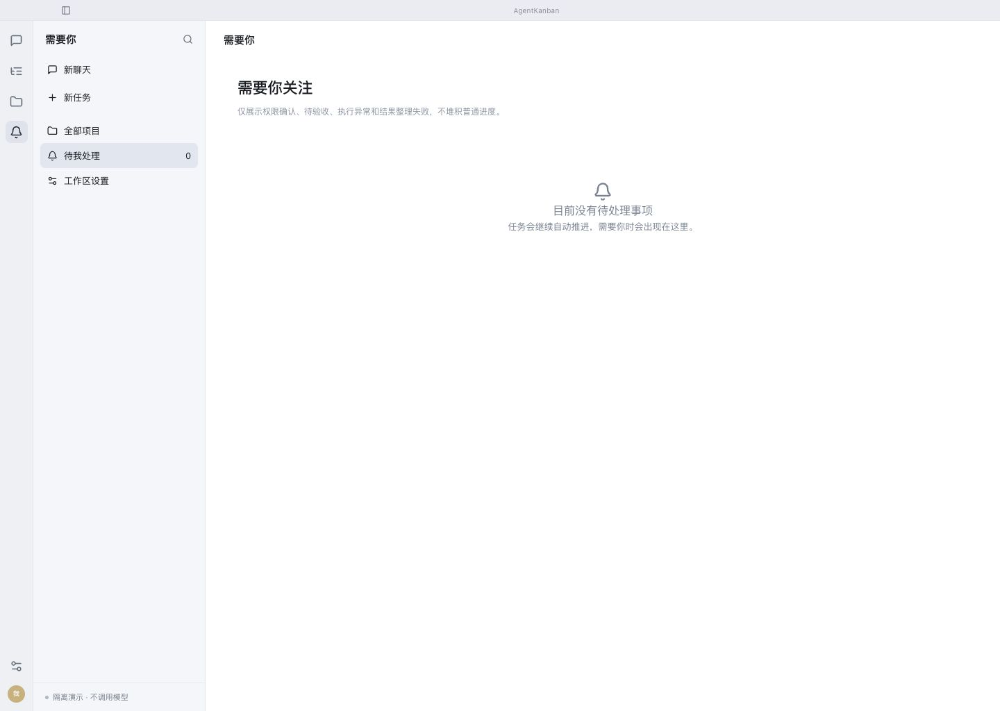
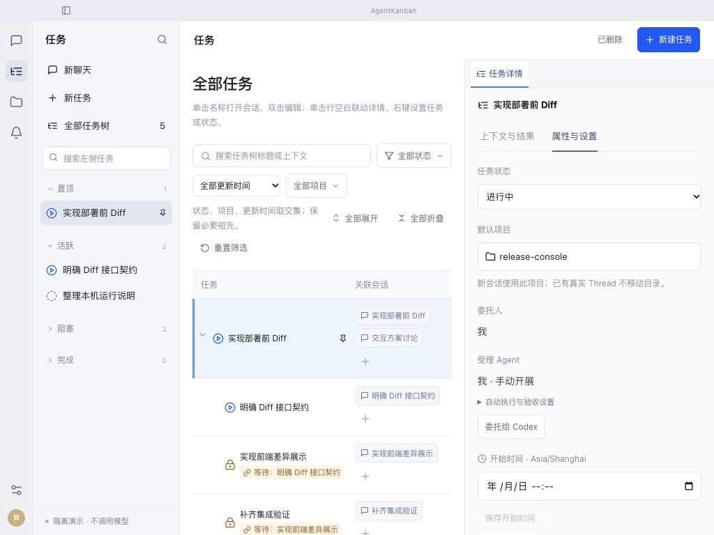

# UI 一致性检查：整改前

日期：2026-10-28。本文保留整改前检查，后续整改已实现、验证并安装。最终结果见 [验收记录](README.md)。

## 范围和证据来源

用户提供的真实 macOS APP 截图，以及当前代码在内置浏览器中运行的隔离演示。演示不连接账号、不启动模型、不访问正式数据库。以下页面均在本轮实际打开并截图；1440×1024 为常规基线，1024×768 检查窄窗口。

截图使用 fullPage 捕获；最初的 viewport 截图出现缩放留白，已弃用并以正确的完整页面截图覆盖。本文不把浏览器表现当成真实 WKWebView 通过，也不宣称已完成键盘或无障碍认证。

## 页面检查

| 步骤 | 页面及证据 | 当前结论 |
| --- | --- | --- |
| 01 | [任务树及属性](before/01-task-properties.png) | 层级树骨架可保留；筛选、状态、项目、日期控件高度不一，详情字段纵向过散、说明文字过浅 |
| 02 | [新建任务](before/02-create-task.png) | 弹窗结构清楚；输入框与项目下拉框明显不等高，原生下拉与自绘按钮风格不同 |
| 03 | [设置页](before/03-settings.png) | 分区结构可保留；字号、说明层级与主操作需要纳入统一规范，禁用文字对比偏弱 |
| 04 | [会话页](before/04-conversation.png) | 阅读区和工作区分工清楚；顶部图标、正文、元信息、输入工具栏需要使用同一套尺寸角色，属性面板问题同 01 |
| 05 | [项目页](before/05-projects.png) | 基础网格可保留；卡片标题、路径、统计与编辑入口需要统一节奏和对比度 |
| 06 | [需要你空态](before/06-attention.png) | 当前演示为空，不能据此评价待批卡片；空态文案、位置和标题层级应与其它页一致 |
| 07 | [窄窗口任务页](before/07-task-narrow.png) | 页面整体未横向溢出；筛选和辅助操作散落多行，任务行因关联会话换行而过高，内容可视面积明显下降 |

## 实测控件差异

在 1440×1024 的当前演示中读取可见控件的 computed style：

| 控件 | 高度 | 字号 | 圆角 |
| --- | --- | --- | --- |
| 状态/项目筛选按钮 | 35px | 12px | 6px |
| 更新时间原生下拉 | 31px | 12px | 6px |
| 属性任务状态原生下拉 | 37px | 13px | 7px |
| 属性项目选择按钮 | 41px | 13px | 7px |
| 日期时间原生输入 | 42px | 14px | 7px |
| 属性值文本 | 24px 行高 | 14px | 不适用 |
| 属性标签/说明 | 19–21px 行高 | 12px | 不适用 |

用户真实 macOS 截图中的平台渐变、系统箭头和日期表现，与浏览器演示不同，说明仍依赖平台原生呈现。

## 代码根因

- `studio.css` 仅 78 行但含约 726 个规则块，存在多轮追加覆盖。同一 `.field-label`、`.field-value`、`.textbtn`、`.field-control`、`.inspector-body` 在不同位置重复定义。
- 任务筛选、属性、创建、模型、权限与高级设置仍使用原生 select；已有 `@radix-ui/react-select` 和通用 Select 组件尚未贯通这些入口。
- 日期时间使用原生 datetime-local，外观、分段和弹层受平台影响。
- 详情字段缺少明确分组，任务状态、执行安排、依赖、会话环境连续平铺；文本颜色多次淡化后层级主要依赖大小和留白。

## 实施后的验收清单

以下为检查阶段拟定的验收清单；实际通过范围及证据见 [最终验收记录](README.md)：

- 同类控件具有一致高度、字号、边框、圆角、图标和状态反馈；保留表单、紧凑工具栏、阅读正文的清楚层级。
- 任务筛选、状态、项目、模型、权限与验收方式统一菜单体系；鼠标、方向键、Enter、Escape、Tab、焦点恢复、禁用项、长选项、边缘定位和弹窗内遮挡均正确。
- 日期输入、清空、取消、保存及本地时区转换保持现有业务语义；运行中不能编辑。
- 1440×1024 和 1024×768 验证六个主要入口和弹窗，不依靠缩小文字掩盖拥挤，不出现横向溢出或菜单裁剪。
- 保留权限设置的版本冲突保护、旧配置兼容、任务状态/预约/依赖等现有行为；运行相关自动测试。
- 在隔离真实 macOS APP 再验收原生选择/键盘/焦点表现。若正式 APP 有活动执行，重启安装前处理明确的停止授权。

## 本轮截图

### 01 任务树与属性

### 02 新建任务

### 03 设置

### 04 会话

### 05 项目

### 06 需要你空态

### 07 窄窗口任务页

