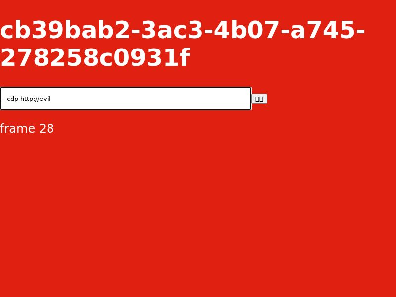
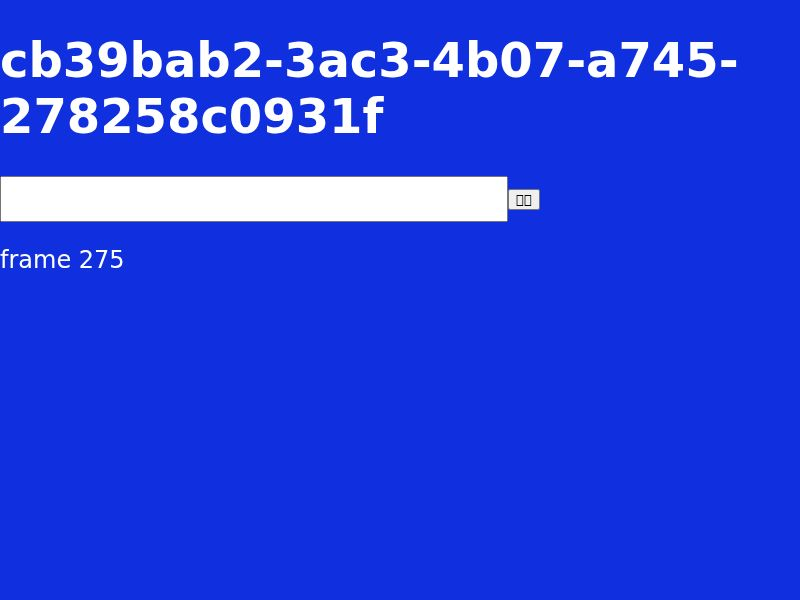

# 阶段 0 真实 Docker／agent-browser 探针结果

最终运行时间：**2026-10-29 14:33:25–14:33:49，Asia/Shanghai**。trace 使用 UTC `Z` 时间。本次结果来自本机真实 Docker、两个独立 Chromium 容器和官方 agent-browser 0.40.0 原生程序；没有调用个人浏览器。

结论：阶段 0 的 CLI/stream、会话隔离、同 profile 重建后 Cookie/localStorage/IndexedDB，以及宿主回环 HTTP/重定向/WS 链路通过。headless-shell 不恢复原生页签，页面恢复使用数据库旁显式 `pages.json`。完整 APP 和实际模型的验收仍未执行。

## 真实执行过程

1. 固定运行依赖。Docker Server 为 `29.8.2 linux/arm64`；sidecar `agent-browser 0.40.0` 的 npm 完整包 SHA512 与固定 integrity 相符，darwin-arm64 文件 SHA256 为 `b064c9107a0431c76d8916e47c2c8ac322f49c2b2720d6c9036ab538ec1ed911`。Chrome 镜像来源为 `chromedp/headless-shell`，arm64 manifest 为 `sha256:d1a6b8b5ae14c1dcc475fa1300586ee3b811f2b39105dedde6f62d68270f4359`，实际运行 config ID 为 `sha256:a8eda062ca7bb9d9696212c14e6e9e8d7c12b599b988e52ec9ec52a7d1a9106d`，版本 `Chromium 157.0.8103.27`。Docker daemon 初始外网下载超时，宿主下载 OCI 并逐对象核验后导入成功；之后 daemon 的原始固定 digest 下载也完成。全程未重启 Docker Engine。

2. 在 `/tmp/akb-bp-812a4112/` 建隔离数据库父目录标记，A/B 的 profile 分别 bind mount 到 `session-browser/a/profile` 与 `session-browser/b/profile`。实际 UID:GID 为 `502:20`，目录权限 `0700`，没有 `chmod 777`、privileged 或 Docker socket 挂载。容器 `akb-bp-812a4112-a/b` 各自发布宿主 `127.0.0.1` 的独立 CDP 端口。两条 CLI session 显式 `connect`，没有自动浏览器发现。

3. 宿主 fixture 仅监听 `127.0.0.1:63442`。容器通过 `host.docker.internal:63442` 打开 `/redirect` 并到达 `/red?marker=redirected`；之后 A 打开随机标记 `cb39bab2-3ac3-4b07-a745-278258c0931f` 的红/蓝两页，B 使用另一个标记。fixture 记录真实 HTTP 和 `/hmr` WebSocket 请求，页面收到 `reply:hmr:<随机标记>`。这些证据说明本机 OrbStack 环境的宿主回环 HTTP、重定向和 WS 可达；不代表所有 Linux Docker 平台已经验证。

4. A/B 写入不同 Cookie/localStorage/IndexedDB。真实 `tab list` 返回各自 CDP target，B 使用 A target 被拒绝。A 通过 stdin 二维 argv 的 batch 将 `--cdp http://evil` 填到 `#text`，随后 `get value` 返回相同文字；它没有被解析成连接配置。`snapshot` 返回的树包含真实页面随机标记和表单，而非提示词构造值。

5. A 的 stream 对不可信 Origin 返回 `HTTP/1.1 403 Forbidden`，本机 `http://127.0.0.1:1420` 返回 `101 Switching Protocols`。连接使用 `?pacing=ack&maxFps=30`。红页首帧 `seq=1`，JPEG 为 `800×600`，背景像素为 `[224,32,17]`。暂停 ACK **10,000ms** 后仍只有一帧；此时 stream 键盘 `char` 输入中文、鼠标点击按钮均立即到 DOM。发送 `{type:"ack",seq:1}` 后第二帧恢复。再设置 `maxFps=5`，六帧首尾间隔 `1009ms`，证明本次输出频率受限制。

6. 关闭红页旧 WS，等 CLI 用真实蓝页 target 切页完成后新建 WS。第一帧 `seq=240`，背景像素 `[16,47,223]`，画面来自蓝页。上游 frame 真实字段只有 `data/metadata/seq/type`，不含 target；本次证明支持“切页重建 WS＋epoch”方式，不能省略产品对迟到异步事件的拒绝。

7. 保存 A 两页 URL 到同数据库父目录的 `session-browser/a/pages.json`，关闭 A 的 CLI session，然后 `docker stop`、`docker rm`。使用**相同完整 profile**重新创建容器，期间没有清空 profile。headless-shell 原生页签没有恢复；读取 pages.json 重开红/蓝页后，Cookie/localStorage/IndexedDB 与重建前逐字段相等。该证据证明完整 profile 的持久存储恢复及显式页面信息恢复；不证明未提交表单或 JS 内存状态恢复。

8. 结束时精确 close 两条 session、stop/rm 本次容器。最终标签查询 `activeProbeContainers=""`，未留下活动 daemon。保留隔离 profile 和页面信息用于人工复核。宿主镜像缓存和已校验 sidecar 留作后续 APP 验证；大镜像 browserless 下载已停止。

## 可复核产物

- [最终完整 trace](final-v2/trace.json)：每步输入、CLI JSON、HTTP/WS、target、容器、profile、帧元数据、断言及清理。
- [红页首帧](final-v2/red-first.jpg) 与 [切页后蓝页第一帧](final-v2/blue-first-after-switch.jpg)。
- [依赖锁](../../../../scripts/session_browser_probe/runtime.json)、[准备及复现命令](../../../../scripts/session_browser_probe/README.md)。
- `headless-shell/`、`headless-shell-attempt-02/` 保留前两轮探针自身路径/采样点问题的失败 trace；`headless-shell-attempt-03/` 和 `final/` 是之前已通过的有界运行。最终结论以 `final-v2/trace.json` 为准。

## 未执行及剩余边界

| 项目 | 本次状态 | 后续完成标准 |
| --- | --- | --- |
| Tauri WKWebView 薄代理、最终绘制 ACK、UI 切会话防旧帧 | 未执行 | 从真实 APP 面板操作并采集 evidence |
| 真实旧 Thread／模型工具共用页面 | 未执行 | 保留 Thread ID/历史/目录/权限，模型读取面板随机标记 |
| Docker Engine 整体重启 | 未执行 | 经允许的维护窗口验证，不影响用户其他容器 |
| APP 升级后的 DB 父目录/profile 保留 | 未执行 | 安装升级前后路径、存储和页面恢复一致 |
| 系统 IME 候选确认、上传下载／拖拽 | 未执行 | 从 APP 入口验证，不以 char 输入或 CLI 支持替代 |
| Linux Docker 本机宿主回环、amd64 镜像运行 | 未执行 | 在目标平台重复本探针并验证有限端口转发 |

依赖辅助脚本已执行 Python 编译、准备到隔离输出、重复固定 config 缓存命中，并以已核验 OCI 缓存实际重新生成 Docker archive/load；Node 探针语法与本轮实际运行通过。
