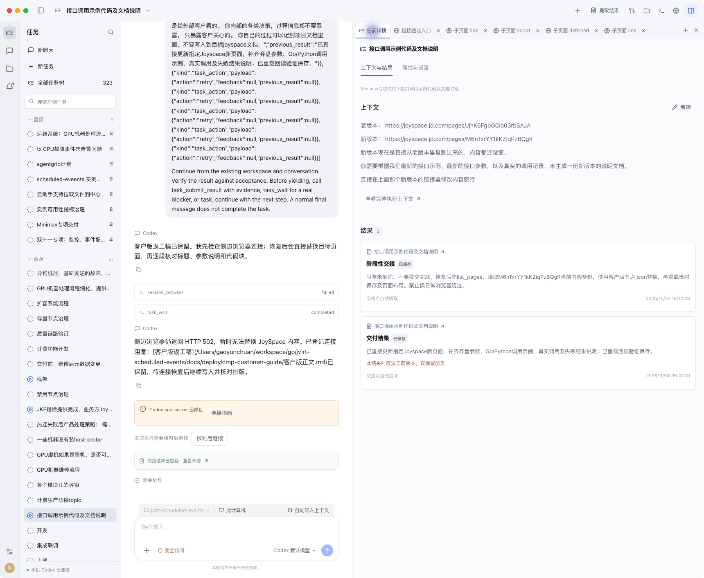

# 网页链接打开侧栏标签

修复已安装并重启。网页请求新窗口时，现在在当前会话的右栏创建并激活新标签，保留原网页；普通当前页链接继续使用当前标签。

## 原因与实现

原生 WebContents 没有设置新窗口 handler，Electron 默认创建独立 BrowserWindow。现在由 `BrowserManager.openWindow` 接管为同 partition 的 WebContentsView，并同步共用标签条。

三项主要边界已处理：

1. 重新加载链接可能丢失 POST 和 opener：有 Electron 预建 guest 时接管同一 WebContents；没有 guest 的路径保留 referrer、POST 数据和内容类型自行导航。
2. 新页面可能绕过原配置或覆盖其它工具：创建前固定同会话 partition、沙箱和隔离配置；沿用原页面显示权规则，隐藏时不显示 view。
3. 页面自行关闭可能留下失效标签：监听 destroyed 统一删除标签并激活可用页面；关闭整个会话先解除归属，避免销毁过程中重新激活兄弟页。

依据：[Electron 38.8.6 实际源码](https://github.com/electron/electron/blob/v38.8.6/lib/browser/guest-window-manager.ts#L58-L93)、[官方新窗口接口](https://www.electronjs.org/docs/latest/api/web-contents#contentssetwindowopenhandlerhandler)。

## 验证

[Node 管理回归](browser-tests.log)7 项通过，[相关前端回归](ui-tests.log)81 项通过。先观察缺少 handler、未清理自关页失败；独立审查补齐 guest 身份、无 guest 导航分支和 undefined 可选参数的失败回归，再修复通过。最终增量独立审查未发现重要阻塞。

实际安装后的 Electron 使用本机 HTTP 页面验收，未调用生产写接口或模型：

| 场景 | 实际结果 |
| --- | --- |
| target blank 链接 | 原页保留，新增并激活子页面 link 标签 |
| window.open | 新增子页面 script 标签，opener 保留 |
| 先打开空白页再赋 location | 子页面 deferred 正常加载，原页面引用有效 |
| POST 新窗口表单 | 子页面 post 正常加载，服务端收到 POST 和中文表单内容 |
| 登录会话 | 所有子页均收到本机测试 Cookie |
| window.close | 当前子标签移除并返回原页 |
| 普通当前页链接 | 复用原标签显示当前页导航页面 |
| 中键打开 | 新增网页标签且加载目标地址，没有停留空白页 |

服务端记录：[requests.jsonl](requests.jsonl)。原生标签与表单摘录：[native-tabs.ax.txt](native-tabs.ax.txt)、[native-middle-click.ax.txt](native-middle-click.ax.txt)。

截图切到任务详情以绕开活动原生网页的白图截屏限制，保留实际新建的标签条；页面内容与请求由 AX 和服务端回读核对。没有用浏览器镜像替代本次原生交互验证。

## 安装与范围

[最终安装摘要](installation.json)记录源码与安装副本哈希一致、ad-hoc 签名严格校验通过。更新前活动执行数为 0。临时服务和测试标签已清理，应用保留运行。未提交或推送代码；Windows/Linux 未做实机验证。
