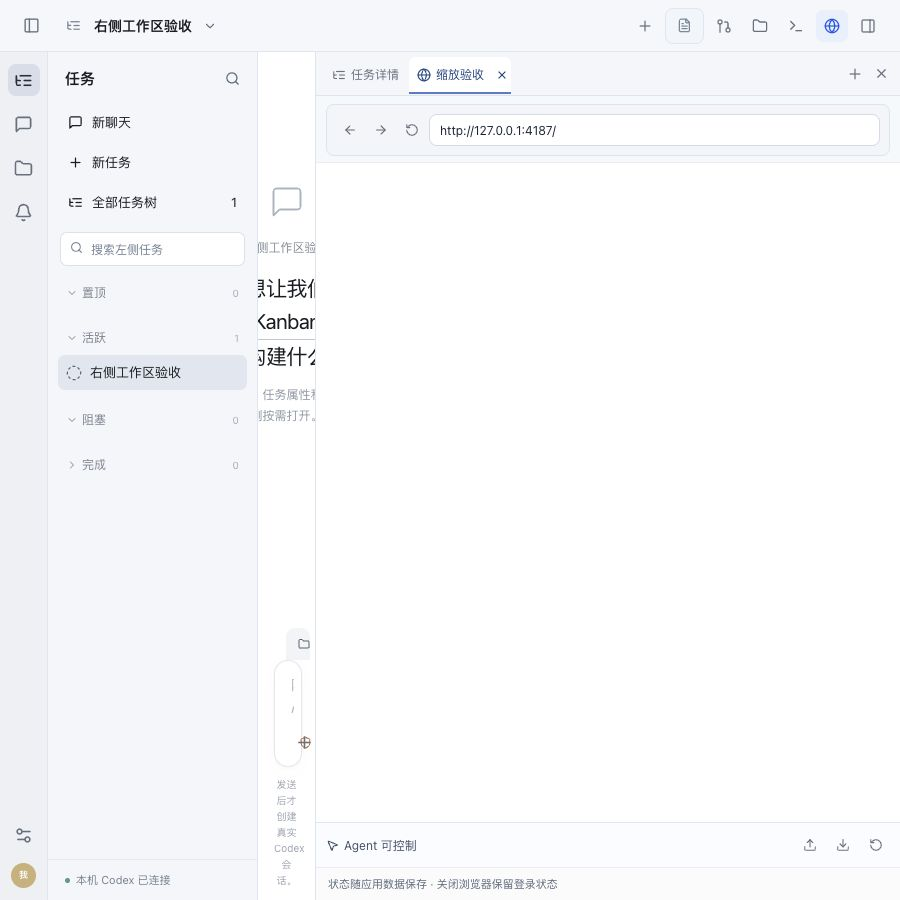

# 窗口缩放后的网页错位修复

修复已安装并重启。窗口变宽时，原生网页现在随右栏更新坐标；隐藏网页后缩放窗口，不会把网页重新显示在其它工具上。

## 原因与改动

右栏达到固定宽度后，横向扩窗只改变位置，宽高保持不变。原实现只监听 ResizeObserver，主进程仍用旧坐标摆放网页。`NativeBrowserSurface` 增加 window resize 监听并重新测量槽位；隐藏或卸载时移除监听。没有改动右栏宽度策略、浏览器权限、任务调度或后端。

对应三项风险均已处理：仅补尺寸监听仍会漏掉位置变化，所以回归明确只改变 x；隐藏网页可能重新抢占显示，所以检查隐藏和卸载后停止上报；只检查静态宽窄页面不能证明连续缩放，所以额外连续改变五档窗口宽度并比对实际回调矩形。

## 验证结果

- [失败回归](regression-red.log)：槽位 x 从 500 变成 1000，原代码最后仍上报 500。
- [相关回归](regression-green.log)：78 项通过，覆盖最新坐标、缩窄、隐藏、恢复、卸载清理。
- [全量前端](frontend-tests.log)：22 文件、203 项通过；[浏览器管理](browser-tests.log)：3 项通过。
- [构建](build.log)通过，独立只读增量审查未发现阻断；[安装](installation.json)核对最终 UI/sidecar 一致，ad-hoc 签名严格检查通过。

连续布局检查使用最终构建和独立 SQLite fixture，不启动模型。将真实 `NativeBrowserSurface.rect` 回调矩形投影为 iframe，便于观察并与真实 DOM 槽位比较；**这是矩形回调镜像，不是 Electron 原生画面的像素截图**。所有坐标、宽高完全相等，页面没有横向溢出，详见 [measurements.json](measurements.json)。

| 连续窗口宽度 | 网页 x | 网页宽度 |
| --- | --- | --- |
| 1800 | 901 | 899 |
| 2200 | 1301 | 899 |
| 1600 | 701 | 899 |
| 900 | 316 | 584 |
| 1800 | 901 | 899 |

前三档网页宽高保持不变而 x 随窗口变化，覆盖本次漏测条件。[visibility.json](visibility.json)确认切到文件、隐藏时继续缩放、收起右栏均不显示网页；恢复后坐标与宽度再次对齐。

## 原生验证及限制

已在安装后的 Electron 中打开本机验收网页，并通过原生窗口的缩放操作核对网页尺寸回报，见 [native.ax.txt](native.ax.txt)。原生截图接口在网页活动时返回白图，因此未完成物理连续拖拽后的原生像素对齐检查；上述截图没有冒充该项证据。纯位置变化由先失败后通过的回归和真实 DOM 连续缩放比对验证。

更新时有一轮“接口调用示例代码及文档说明”执行，已通过后端 `workbench_shutdown` 收到停止确认后更新；该轮状态为 superseded，没有代用户提交业务结果或自动重试。测试网页、独立后台、临时 HTTP 服务已清理，正式应用保留运行。代码未提交或推送。
