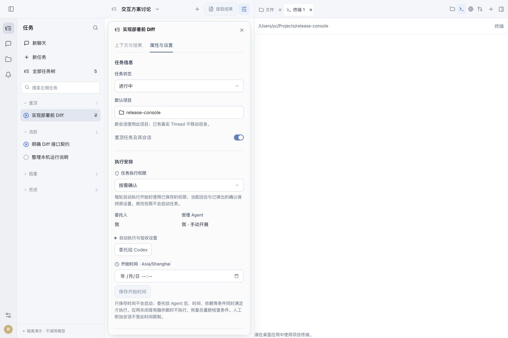
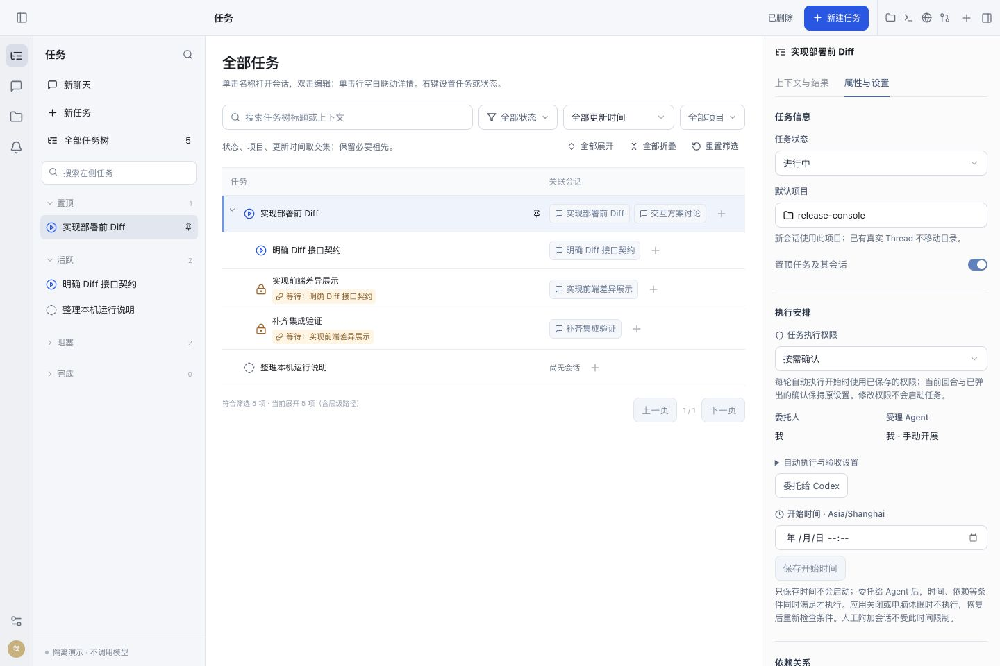
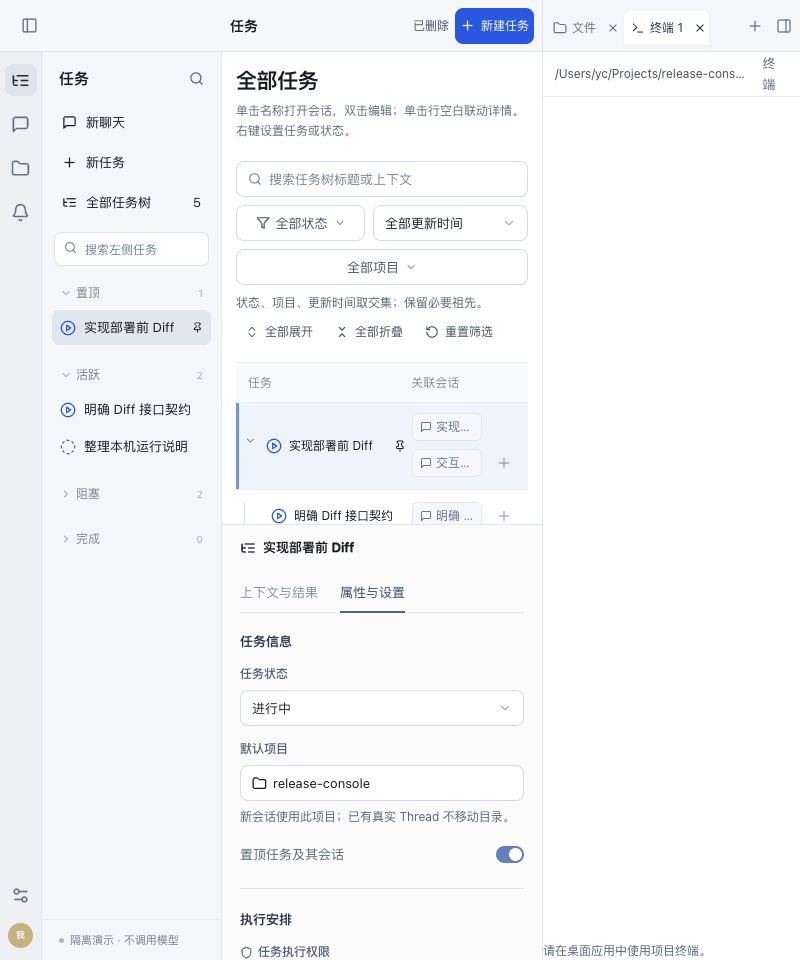

# 顶栏分区验收

已安装并重启当前 Mac 的 Electron 应用。最顶部一行区分中间业务操作与右侧工具标签；会话属性默认收起，任务树属性固定显示；工具可独立收起恢复。

## 已验证行为

| 验收场景 | 结果 |
| --- | --- |
| 顶栏区域归属 | 提取结果/会话属性在中间 toolbar；文件、终端、网页、变更及标签在右 toolbar |
| 属性默认状态 | 会话默认收起，任务树固定打开且无收起按钮 |
| 两边状态独立 | 查看/提取结果不切换工具，工具收起不收起任务树属性；Inspector 草稿与已选页签保留 |
| 资源恢复 | 文件单例、多终端和跨页面标签回归通过；原生文件收起恢复保留 go.mod，终端恢复同一标签并可关闭 |
| 宽窄窗口 | 1440、1024、800、1600、1440 连续测量，工具头与正文 x/width 相等，页面无横向溢出 |
| 窄任务树 | 属性接在任务树下方，二者边界相等且属性可见，无收起按钮 |
| 侧栏开关 | 800 宽度下收起左导航后，工具头与正文仍对齐 |
| 原生浏览器 | 顶部网页标签、本机页面、工具新建菜单可操作，测试页已关闭 |

自动化：[205 项全前端测试](frontend-tests.log)、[7 项浏览器管理回归](browser-tests.log)通过；新增布局回归先观察失败再修复，见 [regression-red.log](regression-red.log)。[UI 构建](ui-build.log)、[打包](package.log)及严格签名校验通过。设计和代码分别进行独立只读审查，未发现重要阻塞。

## 可见证据

图片来自最终构建的隔离演示页面，不调用模型或生产接口。原生应用截屏返回白图，已剔除；原生功能证据通过 AX 与实际操作留存，不冒充像素截图。

坐标明细见 [measurements.json](measurements.json)。原生操作摘录见 [native.ax.txt](native.ax.txt)和 [native-browser.ax.txt](native-browser.ax.txt)；实际读取 `module jd.com/jvirt/jvirt-scheduled-events`、`go 1.20`，文件收起恢复后保留。真实终端输入 pwd、收起恢复同一“终端 1”、关闭标签均完成；不把 AX 中静态目录标签冒充 Shell 输出校验。

## 安装与清理

[installation.json](installation.json)记录最终 UI 与安装副本一致、签名通过、安装前活动执行数为 0。后端代码摘要未变，复用已安装且校验匹配的 sidecar，避免重新生成 Rust 全量缓存。无权限、数据库、任务执行逻辑改动；没有提交或推送代码。

安装验证后删除 `src-ui/dist`、`desktop/ui`、`desktop/dist-electron`、临时 `src-tauri/target`；清理结果见 [cleanup.json](cleanup.json)。临时网页、预览服务和本机验收服务已关闭，正式应用继续运行。Windows/Linux 未做实机验收。
