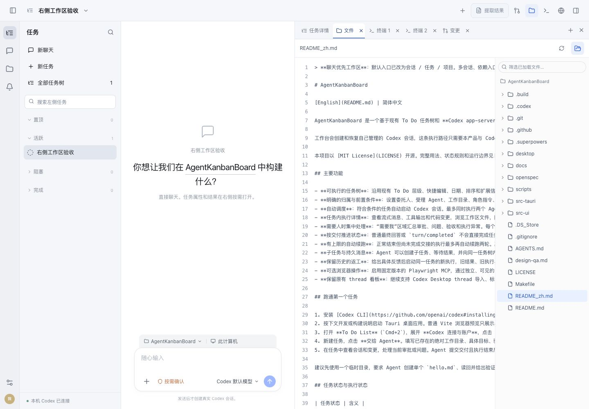
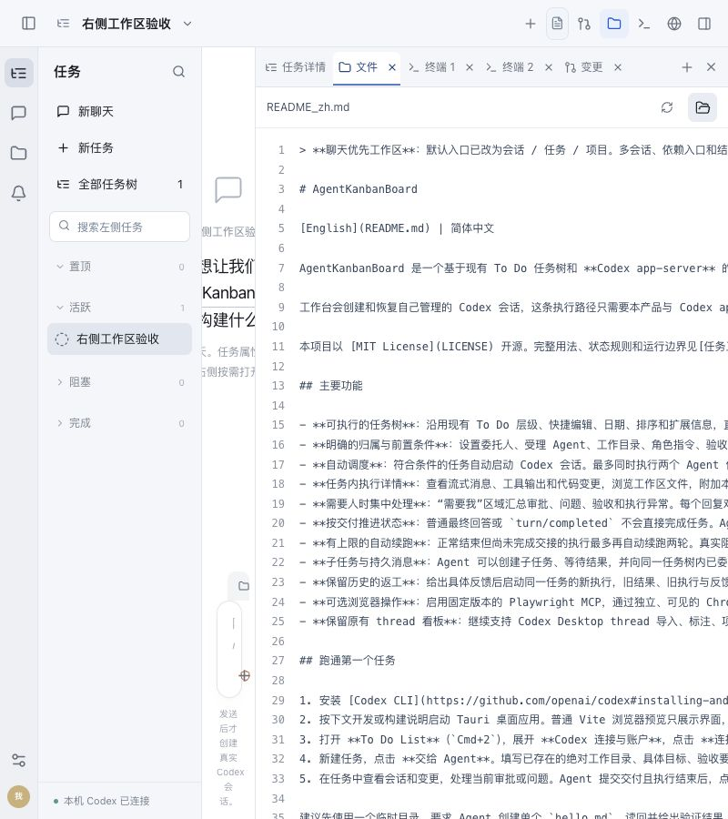
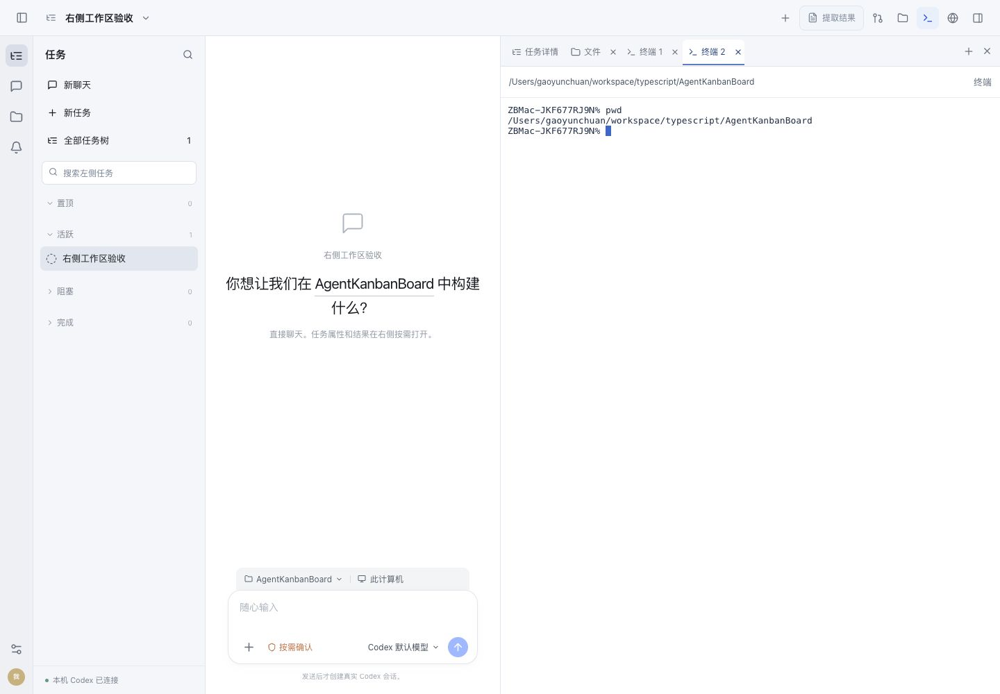

# 右侧工作区验收记录

2026-10-30，本机 macOS arm64 Electron 开发包。最终源码基线及文件摘要见 [source-snapshot.json](source-snapshot.json)，安装签名、文件一致性、重启记录见 [installation.json](installation.json)。本次没有提交或推送代码。

## 交付行为

- 共用一层标签条：任务详情、每个真实网页、文件、多个终端、变更。浏览器没有第二层网页标签。
- 文件和变更在当前会话中各为单例；再次点击激活原标签并保留文件选择。文件内容在左、目录树在右，可用文件夹按钮收起。关闭文件页后换项目重开使用当前目录。
- 每个终端是持续交互 Shell，初始目录为创建时的当前项目。切换标签、会话、项目管理页不结束已有 Shell。
- 用户已明确选择：只限制 Agent 之间的项目并发。浏览器、文件、人工终端不参与 Agent 的目录锁和并发额度；多个终端可以并行。终端仍使用任务当时的沙箱，不扩大文件访问权限。受限 macOS Shell 使用 `zsh -f`，避免用户启动脚本写入 HOME 导致权限报错；完全访问使用登录 Shell。

## 关键问题与补救

1. 多终端可能遗留进程或积累输出：每个终端最多保留 1 MiB 输出、全应用最多 8 个终端；关闭需确认进程退出，退出应用先终止终端再停 app-server。关闭失败保留标签并显示错误。
2. 项目切换和迟到响应可能显示旧内容：标签固定创建时目录，文件请求有代际隔离；关闭单例时清理目录元数据。对应回归先观察失败后修复通过。
3. 原生网页视图可能遮挡文件、终端或菜单：由右栏活动状态和弹层控制展示，后台 Agent 切网页不重新覆盖其他工具；浏览器管理 3 项回归通过。

## 自动化与构建

| 验证 | 实际结果 | 证据 |
| --- | --- | --- |
| 全量前端测试 | 22 文件、202 项通过 | [frontend-tests.log](frontend-tests.log) |
| 全量 Rust 测试 | 204 库测试、1 主程序、1 集成，共 206 项通过 | [rust-tests.log](rust-tests.log) |
| Electron 浏览器管理 | 3 项通过 | [browser-tests.log](browser-tests.log) |
| 本机打包助手 | 19 项通过 | [packaging-tests.log](packaging-tests.log) |
| UI / release sidecar | 均构建成功 | [ui-build.log](ui-build.log)、[sidecar-build.log](sidecar-build.log) |
| npm 锁文件 | npm 10/11 `ci --ignore-scripts --dry-run` 均通过；只新增两项 xterm 依赖 | `src-ui/package-lock.json` |
| OpenSpec / 空白检查 | 严格校验及 `git diff --check` 通过 | `openspec/changes/codex-right-workspace-tabs/` |

合计 430 项自动化测试通过。Rust 回归覆盖：同项目 Agent 与人工工具并行但 Agent 之间仍互斥、终端归属、输出与数量上限、输入上限、关闭隔离；超 3 MB 文件在 `fs/readFile` 请求前拒绝，保证共享连接存活。

## 真实运行与可见证据

使用真实 release sidecar 和独立 SQLite 数据库，未启动模型，也未触发生产接口：

- 同项目双 Shell 实际 `pwd`、独立 `cd`、中文输出、Ctrl+C、resize、关闭一个后另一个继续运行，全部通过：[pty-smoke.json](pty-smoke.json)。最终 release 二进制重新执行通过。
- 1440 与 800 宽度验收：实际读取项目 README、切换两个终端与变更、收起目录树、文件内容保持，页面没有横向溢出。前端使用同一构建产物并连接隔离的真实 sidecar：[ui-fixture.json](ui-fixture.json)。
- 原生应用实际验证两个网页独立标签、文件读取 `go.mod`、目录树收起、双终端输入与关闭、变更页、新建菜单；摘录见 [native-tabs.ax.txt](native-tabs.ax.txt)。原生截图接口返回白图，因此这里的图片明确来自上述隔离验收界面，不冒充原生像素截图。
- 最终安装后已启动，默认任务树可见；安装副本与最终 sidecar、UI、main/preload 源产物哈希一致，ad-hoc 签名严格检查通过。退出旧进程后核对主程序和所拥有 sidecar 均已停止；验收终端、独立服务、预览网页均已清理。

## 验证边界

本次交付和安装范围为当前 Mac 的 Electron 应用；未做 Windows/Linux 实机验收、正式公证分发或生产发布。未执行真实模型与双终端同时修改仓库的实验；并发调度行为由 fake app-server 的业务回归验证，真实双终端由独立运行验证。多终端可同时写同一文件是用户明确选择的行为，不做目录互斥。没有改写业务任务结果或替用户执行文档发布。
