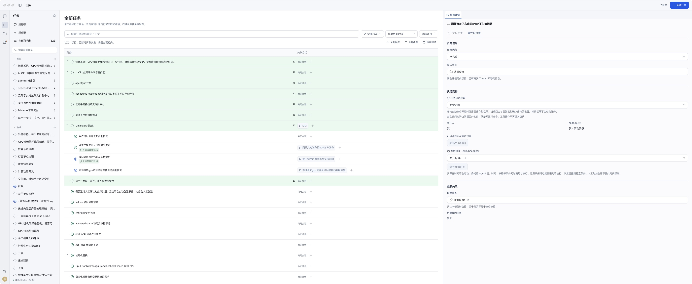
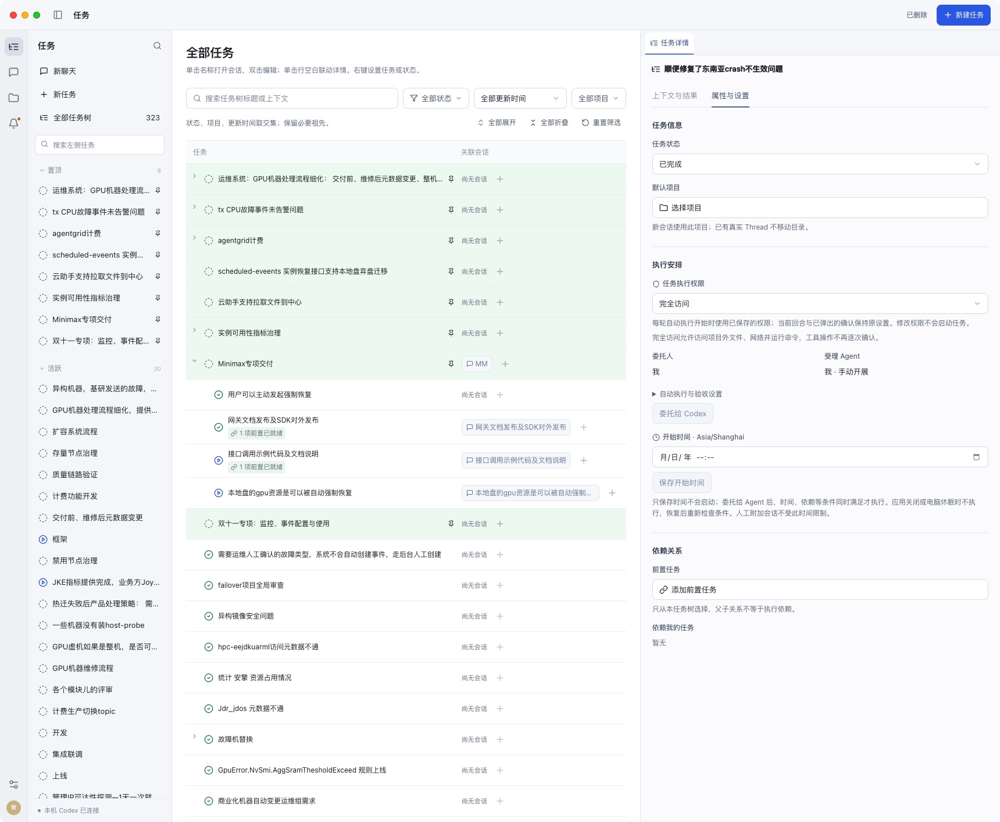

# 单层工作区顶栏验证

日期：2026-10-30。代码为 main 未提交差异。用户要求参考 Codex，把窗口控制、标题及操作合为一条 header。

## 实际结果

Electron macOS 采用 hiddenInset，原生红黄绿保留；React 仅有 WorkspaceHeader。任务、项目、需要你、设置不再叠加页面工具栏，会话原操作迁入顶栏。标题、定位图标、会话切换同一行；右侧保留操作区域。

## 验证范围

- 单一 banner 的组件回归先失败后通过；任务新建、项目添加及侧栏控制仍可操作。全量前端 185/185 通过。
- 浏览器中会话定位按钮、标题、操作区中心线一致，顶栏高 52px；1440 宽与 800 宽下 scrollWidth 等于 viewport，无页面横向溢出。
- 会话切换菜单完整显示，未被标题文本裁剪，选项可见。宽窄截图见 tasks-1440.png、conversation-800.png。
- 独立审查修复三处边界：继承的纵向布局、标题区域裁剪菜单、实际标题悬浮区域需要 no-drag。最终只在文字层省略，菜单位于可见层，按钮/标题交互区域 no-drag，其余顶栏留白 drag。
- 实际 macOS 安装窗口显示一条顶栏和原生窗口按钮，页面切换后的任务操作出现在右侧；截图 native-chat.png、native-tasks.png。未量化物理拖动位移；拖动边界以 Electron 配置与最终 DOM/CSS 核验。Windows/Linux 原生控制覆盖已配置，未在这两个平台实机验收。
- UI build、Electron 包构建、严格 codesign 与安装/构建 sidecar、main.js SHA256 一致性通过。后端本轮未再修改，沿用同会话 203 条 Rust 与 19 条 Python 回归；合计 407 条自动测试通过。

## 安装与任务安全

用户已批准停止当前轮并更新重启。正式任务先暂停，确认无当前执行、聊天执行与资源租约后备份数据库和旧应用；与任务权限功能一次安装并重启。

安装后“接口调用示例代码及文档说明”仍暂停，权限保持原值；没有替用户批准旧浏览器请求，没有自动恢复任务。见 [安装记录](installation.json)、[数据库备份](database-backup.json)。

代码未提交或推送。本次仅合并顶栏，不改变业务状态语义。

## 追加：任务树作为默认入口

主导航顺序调整为任务、会话、项目、需要你；启动直接打开全局任务树。`Cmd/Ctrl+1` 进入任务，`Cmd/Ctrl+2` 进入会话。新增启动/导航顺序回归先失败后通过，原聊天相关测试显式进入会话后继续验证原行为；全量前端 186/186 与 UI build 通过。

已重新打包、安装并重启正式应用。实际启动窗口任务在第一位、会话第二，直接显示全局任务树；原生 Cmd+2/1 往返验证通过。安装资源与构建产物一致，严格签名校验通过，此前暂停的任务仍保持暂停。见 [安装记录](task-first-installation.json)。

