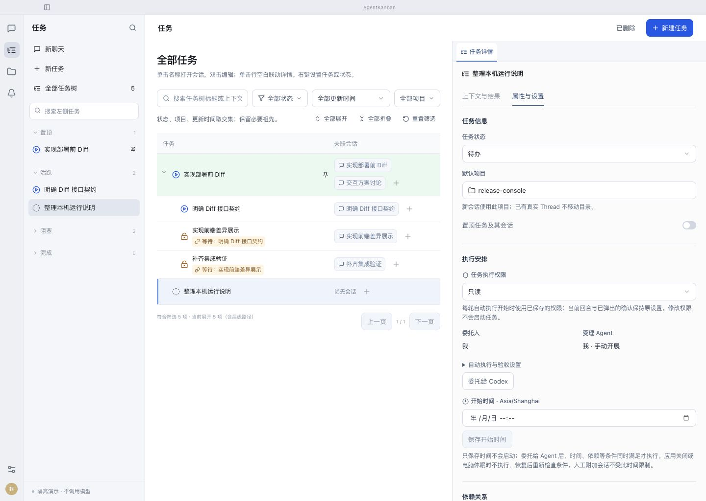

# 任务属性中的执行权限

日期：2026-10-30。代码为 main 上未提交修改；包含本会话此前的依赖修复，未覆盖或回退该改动。

## 用户可见行为

“任务详情 → 属性与设置 → 执行安排 → 任务执行权限”提供按需确认、只读、完全访问，修改后点击“保存任务权限”。无会话也能保存，不会启动执行。

新任务冻结创建时默认值；每轮启动使用该任务当时保存值，当前回合及其待处理请求不被权限变更自动批准。自动主会话的原权限入口同步；独立人工会话仍有各自配置。

## 验收证据

| 场景 | 结果 |
| --- | --- |
| 原实现任务权限字段缺失 | Rust 断言得到 Null、前端找不到属性权限选择器，均先失败后通过 |
| 创建时默认、后改全局默认 | 原任务保留，新任务采用新默认 |
| 无会话保存、创建人工会话 | 不启动执行，新人工会话继承任务权限 |
| 等待中修改、依赖就绪后启动 | `run_started` 记录新权限 |
| 当前回合修改、恢复下一回合 | 假 app-server 实际收到的两次 turn/start 分别为 on-request/workspaceWrite 与 never/dangerFullAccess，原审批不被代答 |
| 父运行中改权限后创建子任务 | 子任务继承父当前回合权限，不使用父下一轮设置 |
| 两入口同步、旧草稿覆盖 | 自动会话同步任务；旧权限基线或会话 revision 被拒绝 |
| 历史与重启 | 保留旧自定义组合，重启幂等；实际数据隔离副本的 5 个工作任务权限未变 |
| 新任务完全访问首次委托 | 复现旧校验拒绝 danger-full-access，修复后通过 |
| 1440×1024、1024×768 | 权限入口可见，页面 scrollWidth 与 viewport 一致，无横向溢出；浏览器演示，不计为正式桌面已生效 |

真实 release sidecar 使用正式数据的隔离副本，无真实模型调用，见 [isolated-backend.json](isolated-backend.json)。截图：[宽窗口](properties-1440.png)、[窄窗口](properties-1024.png)。

全量前端 184 条、Rust 库 201 条及其他 2 条通过；Python 构建工具 19 条通过。首次前端全量中原有 201 行分页用例在 5 秒限制下超时；未改超时或实现，后续两次全量分别 182/182、184/184 通过。UI、release sidecar、Electron 应用包构建与签名完整性校验通过。

独立只读审查无可行动发现，另跑权限专项 5/5 通过。本次修改方法按职责检查，保存、同步、迁移、默认解析和运行快照各自独立；新增说明注释使用中文。全仓历史格式问题见同日依赖修复记录，未扩散修改。

## 本机切换状态

用户已明确授权停止当前轮并更新重启。经正式入口暂停目标任务，确认 current_run_id 为空、资源租约为 0 后备份数据库，再与单层顶栏功能一起安装。安装签名与二进制一致性通过；重启后正式属性面板出现任务执行权限，见 [实际截图](native-properties.png)、[安装记录](installation.json)、[停止记录](approved-stop.json)。

目标任务仍暂停，原按需确认权限未自动放宽，也未重放或代答旧审批。当前用户可在属性中自行调整后恢复。
