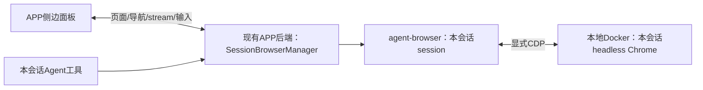

# 简洁会话浏览器设计

## 目标与已确认选择

2026-10-29用户选择：本地Docker运行headless Chrome，每个会话管理自己的页面，使用agent-browser streaming展示和操作。此前把网页操作扩展为完整远程桌面的方案过大，本版替换该方案。

完成标准：用户在A会话打开页面，A的Agent能列出并操作同一页面；用户看得到结果；B会话及日常Chrome/Arc不被混入；基本网页操作流畅可用。

## Approaches

| 方案 | 取舍与结论 |
| --- | --- |
| 本地Docker Chrome＋agent-browser streaming | 用户选择的方向；只接页面管理、实时画面和操作，复用APP后端 |
| 多会话共用一个Chrome，仅分标签 | 容器较少，但共用CDP不隔离Cookie/存储，页面列表与当前页容易误路由；首版不采用 |
| 完整远程桌面 | 覆盖系统窗口但增加桌面与媒体运维，用户已明确排除 |

推荐默认值由实现者负责：一个**活跃会话对应一个Chrome容器**，按需启动，最多4个同时运行；不是为全部历史会话预建容器。后续有证据需要节省资源时再考虑browser context共享。

## 结构

只新增APP内的浏览器管理模块及薄桥接，不拆独立平台服务。agent-browser作为固定版本本机sidecar，Chrome在Docker；UI与Agent都经过同一管理模块。APP进程内保留有限的owner→container/session/CDP/stream/active_target/epoch记录，容器带本APP namespace和会话标签。

### 会话、页面与工具

- owner使用逻辑conversation ID；自动主会话兼容既有task运行键，统一在后端解析。模型不能传入其它owner、任意CDP endpoint或默认session。
- 同owner始终使用同一显式agent-browser session和Docker endpoint。禁用auto-connect及通用Chrome/Arc发现；连接失效明确报错。
- `list_pages / open_page / select_page / close_page / snapshot / act`是一个会话绑定工具接口的操作；内部复用agent-browser。列表来自真实targets，包含稳定target ID、标题、URL和当前页。
- UI与Agent的导航/切页/变更按owner串行；人工接管时暂停本会话Agent浏览器变更，交还后重新读取页面，不补执行旧点击。只读列表可继续使用。
- 旧Thread在正常冷恢复时接入稳定的本机MCP桥，保留Thread ID、历史、目录和权限；不依赖创建时的browser_enabled。先用真实旧Thread验证启动/恢复参数，不能伪造warm-resume可动态加工具。

### 展示与操作

APP提供地址栏、后退/前进/刷新、新建/切换/关闭页签；画面和键鼠使用agent-browser的WebSocket streaming。使用maxFps及最终绘制后的ACK控制画面积压，输入独立于帧发送；隐藏面板断开画面连接，浏览器仍可执行。

本机薄桥接解决Tauri origin与上游WebSocket来源限制：仅监听loopback、仅转发注册owner的固定stream、只接受本APP来源与短期本机连接凭据，不开放任意代理。ACK必须从最终绘制端转发，不能在中间收到图就提前确认。

切会话或切页时清空旧画面并暂缓坐标输入；所有异步响应携带owner/epoch，输入核对target与viewport。阶段0先证明stream切页后的帧确实来自新target；不能仅把旧帧标为新target。上游缺少必要目标信息时，在实际stream绑定处做最小适配或修订该契约，不扩展为另一个截图系统。

中文输入在composition提交时发送完整文字，组合期间不重复发逐键字符；保留键盘导航、选区和快捷键。剪贴板、上传/下载通过agent-browser既有能力加薄UI适配接通，不认为stream会自动完成本机文件传输。系统文件对话框改用APP本地选文件入口；网页弹窗按真实类型展示/响应。具体命令以固定版本契约测试为准。

### Docker与生命周期

- APP管理的容器固定镜像digest、独立持久profile，CDP仅发布到宿主loopback；不挂载个人Chrome资料或宿主Docker socket到Chrome容器，不使用privileged。
- 初次打开/获授权浏览器操作才启动，先ready再开放输入；同owner并发启动合并成一次。关闭面板仅停流，关闭浏览器/退出APP停止自己拥有的sidecar与容器；异常退出后下次启动按精确标签清理孤儿。
- 用户追加硬要求：完整Chrome profile、下载区与页面恢复manifest位于**当前已打开数据库父目录**下的`browser-state/<数据库文件名>/<安全owner编码>/`，再bind mount到容器固定目录。默认例：`~/.codex-kanban/browser-state/app.db/<owner>/profile/`。通过Repository实际connection路径派生，遵守数据库路径override，不硬编码HOME或APP安装目录；两个DB同目录仍隔离。
- 浏览器关闭/容器删除/APP升级只回收运行资源，永不顺带删除持久状态；不按空闲天数自动清登录。Chrome版本固定，升级Chrome时先备份并验证profile兼容，禁止新旧Chrome同时使用同一profile。宿主权限0700、profile OS文件锁跨崩溃自动释放；不能只创建一个永远残留的锁文件。
- 保存完整profile承接Cookie、localStorage、IndexedDB及Chrome自身状态；另用有版本的pages manifest原子保存页面URL/标题/当前页。重建时重新获取target ID，恢复页面不重放表单提交或未知工具操作；manifest损坏明确报错并保留原件，不清空重建掩盖数据丢失。Cookie还需验证固定Linux存储配置在容器重建后可读，不能仅证明文件存在。
- 建议每容器2vCPU/2GiB、最多16页；持久目录有数量/磁盘预算、空间不足停止新增写入并提示清理，绝不自动删除状态来制造恢复通过。cache与临时传输可清理，profile和已保存页面不可混入清理选择器；容量细节及待证集中在capacity.md。
- 容器访问宿主开发页使用host.docker.internal；Linux按Docker平台适配。仅监听127.0.0.1的服务必须真实验证，必要时增加仅指定开发端口的本机转发，不要求用户把开发服务暴露公网。验证重定向、WS/HMR和上传。
- Docker缺失、容器启动失败或达到4实例上限时，仅浏览器显示错误/可关闭实例，不阻塞聊天。副作用不自动重试，容器重启后epoch变化，不重放未知提交。

## 三个主要漏洞与补救

1. 共用Chrome后仅过滤标签无法隔离Cookie或防止误选页：首版按会话独立容器，UI与工具统一owner路由，测A/B随机标记与Cookie。
2. stream不等于完整浏览器桌面，也不会自动解决输入法/剪贴板/文件：APP提供工具栏及必要适配，逐项实测；核心网页能力不足时修复适配，不回到远程桌面架构。
3. Docker网络、版本和资源可能使“能显示”仍不可用：先测宿主开发页、固定版本stream契约和双容器预算；保留硬上限及明确错误，不靠默认Chrome或无限重试兜底。

## 实施与验收

先交付双容器／两个session的真实双向操作，再验证完整profile跨容器重建恢复并替换APP stream与页面管理，最后验证旧Thread与真实客户端。阶段0与用例见test-plan.md，资源草案见docs/data-safety/session-browser/capacity.md。用户已确认该方案并要求持久状态；目前进入实施，运行验收尚未通过。

依据：[streaming](https://agent-browser.dev/streaming)、[CDP](https://agent-browser.dev/cdp-mode)、[session隔离边界](https://agent-browser.dev/sessions)、[Docker网络](https://docs.docker.com/desktop/features/networking/)。本机此前agent-browser为0.23.4，不能直接拿latest文档当已安装能力；实现前固定通过契约测试的sidecar版本，不全局升级用户CLI。
